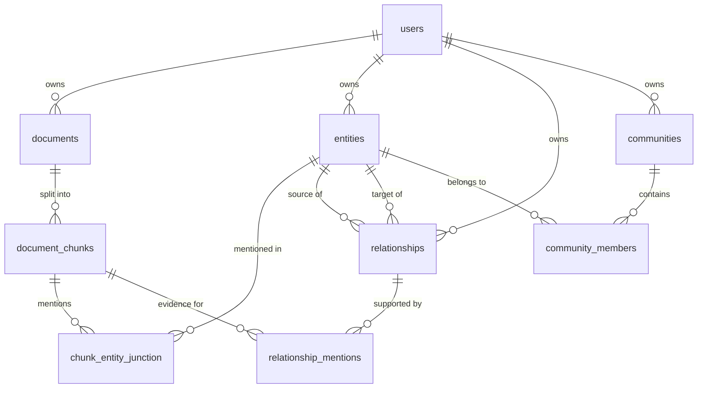
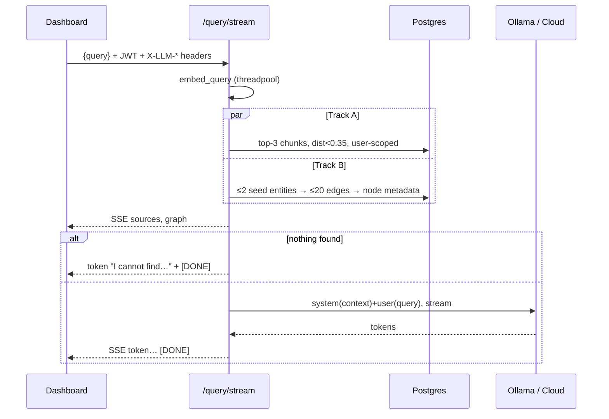

# PKOS — System Architecture Document

| Field | Value |
|---|---|
| Document | 03 — Architecture |
| Version | 1.0 (verified against code, 2026-10-23) |
| Related | [01_PRD](01_PRD.md) · [02_SRS](02_SRS.md) · [04_UI_UX](04_UI_UX.md) · [05_Dev_Plan](05_DEVELOPMENT_PLAN.md) |

Status legend: ✅ implemented · 🟡 partial · ❌ planned.

---

## 1. Architecture at a glance

PKOS is a **single-machine, three-process application** plus a local model server:

```
 Browser (React SPA, :3000)
        │  HTTP/JSON, multipart, SSE  (Bearer JWT)
        ▼
 FastAPI app (Uvicorn, :8000) ──── in-process: SentenceTransformer (bge-small, CPU)
        │                 │                         GraphWorker task (graph extraction) + BackgroundTasks (summaries)
        │ asyncpg pool    │ HTTP (httpx/requests)
        ▼                 ▼
 PostgreSQL + pgvector   Ollama (:11434)            ── optional ──▶ OpenAI / Anthropic APIs
 (:5433 default)          llama3.2 (default)                       (only if user opts in)
```

Design principles: **local-first**, **one database for everything** (relational + vectors + graph in Postgres — no separate vector DB or graph DB), **stream everything to the user**, **keep it a modular monolith**.

## 2. Tech stack (actual)

| Layer | Technology | Version (from manifests) | Notes |
|---|---|---|---|
| Frontend | React | ^19.2.4 | Function components + hooks, Context for auth |
| Build tool | Vite | ^8.0.4 | Dev server fixed to port 3000 (`strictPort`) |
| UI libs | lucide-react, react-markdown + remark-gfm, react-force-graph-2d | ^1.8, ^10.1, ^4.0, ^1.29 | No CSS framework; inline styles + `index.css` tokens |
| Backend | FastAPI + Uvicorn[standard] | unpinned | Async; lifespan creates DB pool |
| DB driver | asyncpg + pgvector (python) | unpinned | `register_vector` on each connection |
| Database | PostgreSQL + pgvector | needs HNSW (pgvector ≥ 0.5) | Default `localhost:5433`, db `pkos_v2` |
| Embeddings | sentence-transformers, `BAAI/bge-small-en-v1.5` | — | 384-d, CPU, singleton |
| Chunking | langchain-text-splitters | — | RecursiveCharacterTextSplitter |
| PDF | PyMuPDF (`fitz`) | — | |
| Auth | PyJWT (HS256), bcrypt | — | |
| Graph algos | networkx (Louvain) | ✅ in requirements.txt (unpinned) | |
| HTTP clients | httpx (async), requests (sync) | **httpx missing from requirements.txt** | |
| LLM | Ollama `/api/chat` (answers), `/api/generate` (extraction, summaries) | — | default model `llama3.2` |
| Legacy | `faiss-cpu` in requirements; empty `backend/data/users/` | — | Leftover from pre-Postgres version; removable |

## 3. Repository layout (verified)

```
pkos_v2/
├─ backend/
│  ├─ main.py                  FastAPI app, CORS, lifespan (DB pool), router mounting, /health
│  ├─ requirements.txt
│  ├─ backfill.py              One-off: embed entities whose embedding IS NULL
│  ├─ graph_baseline.py        Read-only graph stats; `--sample N` times extraction on N random chunks
│  ├─ graph_maintenance.py     Dry-run/--apply clean-up: noise removal, duplicate merge, predicate normalisation
│  ├─ clean_headers.py         Dry-run/--apply: strip running heads from already-ingested PDF chunks, re-embed, drop header-only entity links
│  ├─ eval_graph.py            vector vs graph retrieval/answer comparison (questions in eval/)
│  ├─ core/config.py           OLLAMA_BASE_URL / OLLAMA_GENERATE_URL / get_ollama_model()
│  ├─ test_distance.py         Manual script: print nearest chunks/entities for a fixed query
│  ├─ api/
│  │  ├─ dependencies.py       get_db (pool from app.state), get_current_user (JWT → user)
│  │  ├─ routes_auth.py        /register, /login, /me
│  │  ├─ routes_ingest.py      /documents (GET), /upload (POST), /documents/{id} (DELETE)
│  │  ├─ routes_query.py       /query (POST, non-stream), /query/stream (POST, SSE)
│  │  └─ routes_graph.py       /graph/cluster, /graph/summarize
│  ├─ core/security.py         bcrypt hash/verify, JWT create; SECRET_KEY (hard-coded!)
│  ├─ database/
│  │  ├─ postgres_core.py      DSN from env, init_db_pool, configure_unified_schema (run as script)
│  │  └─ auth_db_pg.py         user CRUD queries
│  ├─ rag/
│  │  ├─ ingestion/            extractors.py (+ headers.py) → cleaner.py → chunker.py, orchestrated by pipeline.py
│  │  ├─ vector/               embedder.py, queue_batcher.py, vector_db_pg.py (all chunk+graph SQL)
│  │  ├─ query/                retriever.py (context formatter), prompt_builder.py, generator.py (LLM providers)
│  │  └─ graph/                extractor.py, reconciler.py, cluster.py, summarizer.py
│  └─ data/users/              empty (legacy)
├─ frontend/
│  ├─ index.html               (title still "frontend")
│  ├─ vite.config.js           port 3000
│  └─ src/
│     ├─ main.jsx, App.jsx     App → AuthProvider → AuthView | Dashboard
│     ├─ index.css             design tokens + layout classes
│     ├─ context/AuthContext.jsx   token state, login/register/logout, authFetch
│     └─ components/
│        ├─ AuthView.jsx       login/register card
│        ├─ Dashboard.jsx      3-pane shell, chat, SSE client, X-Ray inspector, force graph
│        ├─ VaultView.jsx      upload zone, document roster, user footer, settings trigger
│        └─ SettingsView.jsx   provider/model/API key modal
├─ venv/                       local Python venv (should be git-ignored)
└─ docs/                       ← these documents
```

Not present: root README, `.env.example`, Dockerfile/compose, migrations, test suite, CI.

## 4. Components

### 4.1 Frontend SPA
- **AuthContext** holds the JWT (`localStorage.pkos_token`), hydrates the user via `/me`, exposes `authFetch` that injects `Authorization: Bearer`.
- **Dashboard** owns chat state (`messages[]` with per-message `sources`), a single global `graphData`, layout widths, and the SSE reader (manual `ReadableStream` parsing on `\n\n`).
- **VaultView** owns the document list and upload/delete calls.
- **SettingsView** persists provider choices to `localStorage` (`llm_provider`, `ollama_model`, `openai_api_key`, `anthropic_api_key`); Dashboard reads them and sends `X-*` headers.
- API base URL is hard-coded `http://localhost:8000` (AuthContext ×3, VaultView ×3, Dashboard ×1).

### 4.2 API layer (`api/`)
Thin routers; all protected routes depend on `get_current_user` and `get_db`. CPU-bound work is pushed to `run_in_threadpool`.

### 4.3 Ingestion pipeline (`rag/ingestion`, `rag/vector`)
Generator-based to bound memory: page → clean → chunk → payload `{text, metadata{document_id, file_name, chunk_index, page_number}}` → batches of 32 → embed → `executemany` insert.

### 4.4 Query pipeline (`rag/query`, `rag/vector`)
Embed query → **dual-track retrieval in parallel** (`rag/query/retrieval.py::retrieve_context`, shared by `/query` and `/query/stream`): (A) top-3 chunk HNSW search, (B) `rag/graph/search.py`: seeds (name match + embedding) → ranked 1-hop edges → up to 2 graph-found chunks via `chunk_entity_junction` / `relationship_mentions` → `[Chunk N]`-labelled context (≤6,000 chars, graph ≤1,800) → build messages → provider-specific streaming generator. Set `GRAPH_LOCAL_EXPANSION=false` to fall back to the pre-G4 path. Evaluation: `backend/eval_graph.py` (questions in `backend/eval/`).

### 4.5 Graph RAG (`rag/graph`)
| Module | Role | Trigger |
|---|---|---|
| `extractor.py` | `extract_chunk()`: one bounded-schema `/api/chat` call + grounding filter, with 150-char sliding context | called by the worker |
| `worker.py` | `GraphWorker`: single asyncio task; claims `graph_jobs` (`SKIP LOCKED`), per-chunk checkpoint, pause/delete aware, `FAILED` + 30 s back-off on Ollama errors, re-queues interrupted jobs at startup | started in `lifespan`; woken by upload / `/start` |
| `vocab.py` | Predicate vocabulary + normaliser (with edge-direction flips), `canonicalize`/`squash` entity keys, `is_noise_entity` | reconciler, extractor, search, maintenance |
| `search.py` | G4 local search: seed entities (name + embedding), ranked 1-hop edges, graph-found chunks | `rag/query/retrieval.py` |
| `reconciler.py` | Embeds entities, upserts nodes, junction rows, and edges (weight += 1) in one transaction per chunk | Called by extractor |
| `cluster.py` | Loads the user's edges into networkx, Louvain (seed 42), syncs level-0 communities (>= 3 members), keeping unchanged ones with their summaries; writes `community_members` | `communities.py` / `POST /graph/cluster` |
| `summarizer.py` | Takes the user's communities with `summary IS NULL`, builds context from the top entities/edges by degree/weight (<= 3,500 chars), LLM JSON `{title, summary}` via `/api/chat`, embeds, updates; stops (leaving the rest queued) if the LLM is offline | `communities.py` / `POST /graph/summarize` |
| `communities.py` | `rebuild_communities()`: cluster then summarise | worker `_maintain()`, API |

Communities are **not yet used** at query time.

### 4.6 Data store
One PostgreSQL database; schema in [02_SRS §5](02_SRS.md#5-data-requirements). ER overview:



Cascade chain on document delete: `documents` → `document_chunks` → `chunk_entity_junction` → trigger deletes orphan `entities` → `relationships` cascade. Edges now cascade through `relationship_mentions` (last mention deletes the edge, otherwise `weight` is recomputed); community membership lives in `community_members` with FKs and deleting a member flags the community `is_stale`. Edges from before G1 have no mentions and are not cleaned up automatically.

## 5. API surface

Base path `/api/v1` (plus `/health` at root). Auth = `Authorization: Bearer <jwt>`.

| Method | Path | Auth | Request | Response | Status |
|---|---|---|---|---|---|
| GET | `/health` | – | – | `{status}` | ✅ |
| POST | `/register` | – | JSON `{email, username, name, password}` | `{access_token, token_type}` | ✅ |
| POST | `/login` | – | form `username`, `password` | `{access_token, token_type}` | ✅ |
| GET | `/me` | ✔ | – | `{user_id, email, username, name}` | ✅ |
| GET | `/documents` | ✔ | – | `{documents:[{doc_id, filename, timestamp}]}` | ✅ (add status) |
| POST | `/upload` | ✔ | multipart `file` | `{message, document_id, filename, total_chunks_processed}` | ✅ |
| DELETE | `/documents/{doc_id}` | ✔ | – | `{message}` | ✅ |
| POST | `/query` | ✔ | `{query}` | `{query, response, sources[]}` | 🟡 Ollama only; unused by UI |
| POST | `/query/stream` | ✔ | `{query}` + headers `X-LLM-Provider`, `X-Ollama-Model`, `X-OpenAI-Key`, `X-Anthropic-Key` | SSE: `sources` → `graph` → `token`* → `[DONE]` | ✅ |
| POST | `/graph/cluster` | ✔ | – | `{status, communities_detected, communities_kept, communities_queued, communities_replaced}` | ✅ |
| POST | `/graph/rebuild` | ✔ | – | `{status:"queued"}` (flags dirty, wakes worker) | ✅ |
| GET | `/graph/status` | ✔ | – | counts incl. `pending_summaries`, `stale_communities`, `rebuild_queued`, `active_jobs` | ✅ |
| POST | `/graph/summarize` | ✔ | – | `{message}` (worker started) | ✅ caller's communities only |
| POST | `/graph/jobs/{doc_id}/start` | ✔ | – | `{status:"PENDING"}` or 409 | ✅ |
| POST | `/graph/jobs/{doc_id}/pause` | ✔ | – | `{status:"PAUSED"}` or 409 | ✅ |

SSE event payloads:
```json
{"type":"sources","sources":[{"filename":"a.pdf","page":3,"text":"…","distance":0.21}]}
{"type":"graph","data":{"nodes":[{"id":"uuid","name":"FastAPI","category":"TECHNOLOGY","description":"…","isPrimarySeed":true}],"links":[{"source":"uuid","target":"uuid","predicate":"USES","description":"…","weight":2.0}]}}
{"type":"token","content":"…"}
[DONE]
```

## 6. Data flows

### 6.1 Upload (write path)
```mermaid
sequenceDiagram
  participant UI as VaultView
  participant API as /upload
  participant DB as Postgres
  participant EMB as Embedder (threadpool)
  participant BG as BackgroundTask
  participant OL as Ollama
  UI->>API: multipart file + JWT
  API->>API: validate ext, size ≤50MB
  API->>DB: INSERT documents (PENDING)
  loop per batch of 32 chunks
    API->>EMB: embed_text_batch
    API->>DB: INSERT document_chunks
  end
  API-->>UI: 200 {document_id, total_chunks}
  API->>BG: run_offline_extraction
  BG->>DB: status=PROCESSING; SELECT chunks
  loop per chunk
    BG->>OL: /api/generate (JSON schema)
    BG->>DB: reconcile (entities, junction, relationships) in txn
  end
  BG->>DB: status=COMPLETED | FAILED
```

### 6.2 Query (read path)


### 6.3 Graph maintenance
Automatic: when a graph job completes, `graph_state.dirty` is set; the worker (idle, no active jobs for that user) runs `rebuild_communities`. Manual: `POST /graph/rebuild`. Legacy endpoints `POST /graph/cluster` (sync) and `POST /graph/summarize` (background) remain, both per user.

## 7. Authentication & authorisation
- Stateless JWT (HS256, 30-day expiry, `sub`=user UUID). No refresh tokens, no revocation list.
- Authorisation = **row ownership**: every query includes `user_id = $current`. Chunks are scoped through `JOIN documents`.
- Passwords: bcrypt with per-hash salt, 71-byte guard.
- Token stored in `localStorage` (acceptable for localhost single-user; XSS surface kept small by not rendering raw HTML).
- **Required changes:** move `SECRET_KEY` to env; scope summarizer by user; parameterise summarizer SQL.

## 8. Configuration

Currently read from environment (with defaults):

| Variable | Default | Used in |
|---|---|---|
| `POSTGRES_USER` / `POSTGRES_PASSWORD` | `postgres` / `postgres` | postgres_core.py |
| `POSTGRES_DB` | `pkos_v2` | postgres_core.py |
| `POSTGRES_HOST` / `POSTGRES_PORT` | `localhost` / `5433` | postgres_core.py |
| `OLLAMA_API_URL` | `http://localhost:11434/api/chat` | generator.py (answers only) |
| `OLLAMA_MODEL` | `llama3.2` | generator, extractor, summarizer |

Hard-coded today (to be moved to env/config module): `SECRET_KEY`, token TTL, CORS origin, Ollama `/api/generate` URL in extractor & summarizer, retrieval params (k=3, max_distance=0.35, seeds=2, max_edges=20), context caps (4,000 / 6,000 chars), cloud model names, frontend API base URL.

**Target:** a single `backend/core/config.py` (pydantic-settings) + `.env.example`, and `VITE_API_BASE_URL` for the frontend.

## 9. Running locally (current, inferred from code)

```bash
# 1. Postgres with pgvector listening on 5433, database pkos_v2 created
# 2. Ollama running, model pulled
ollama pull llama3.2
# 3. Backend
cd backend
pip install -r requirements.txt
python database/postgres_core.py                  # creates extension + schema (not done on startup!)
uvicorn main:app --host 127.0.0.1 --port 8000
# 4. Frontend
cd ../frontend && npm install && npm run dev      # http://localhost:3000
```

## 10. Security architecture

| Concern | Current | Target |
|---|---|---|
| Data locality | All local with Ollama | Same; cloud providers behind explicit warning |
| Secrets | JWT key in source; DB creds default `postgres` | `.env`, startup check |
| Transport | HTTP on localhost | Fine for localhost; TLS via reverse proxy if ever exposed |
| Network exposure | Depends on uvicorn `--host` | Default `127.0.0.1`; docs warn against `0.0.0.0` |
| Injection (SQL) | Parameterised except summarizer | All parameterised |
| Prompt injection | `===` stripping, strict system prompt | + label untrusted context, eval tests |
| Error leakage | `str(e)` in upload/graph 500s | Generic messages + server logs |
| Cloud API keys | Browser localStorage → per-request header; not persisted server-side | Same; never log headers |
| Dependency hygiene | Unpinned | Pinned + `pip-audit`/`npm audit` |

## 11. Deployment

**Target model: local desktop install** (not cloud). Recommended packaging:

```
docker-compose.yml
 ├─ db:        pgvector/pgvector:pg16, volume pkos_pg, port 127.0.0.1:5433
 ├─ api:       python:3.11-slim, uvicorn, env_file .env, depends_on db, HF model cache volume
 └─ web:       node build → nginx serving dist, port 127.0.0.1:3000
Ollama runs on the host (GPU access); api reaches it via host.docker.internal:11434
```

Startup sequence: db healthy → api runs migrations/`configure_unified_schema` → api serves → web served. The embedding model (~130 MB) downloads on first use; cache it in a volume.

## 12. Monitoring & operations
Proportionate to a local app — no external telemetry.
- Structured logging already configured (`%(asctime)s - %(name)s - %(levelname)s`). Add request id and timings for: embed, retrieval A/B, time-to-first-token, total generation, per-chunk extraction.
- `/health` should check DB (`SELECT 1`) and Ollama (`GET /api/tags`) and report each.
- Optional `GET /api/v1/stats` (per user): documents, chunks, entities, edges, pending extractions.
- Backups: `pg_dump` of `pkos_v2` documented in README.

## 13. Scalability & performance
Expected scale: 1–5 users, up to ~10k documents / ~1M chunks per machine.
- **pgvector HNSW** handles this comfortably. Note: the `WHERE user_id … AND distance < x` filter is applied *after* HNSW candidate selection; with many users, tune `hnsw.ef_search` or add per-user partial indexes if recall drops.
- **Embedding** is the ingestion bottleneck on CPU; batching (32) is in place. GPU or ONNX runtime are later options.
- **Graph extraction** is the slowest part (one LLM call per chunk, sequential). Next step: a persistent job table + single worker process, resumable, with progress counts. Avoid Celery/Redis unless needed — a Postgres-backed queue (`SELECT … FOR UPDATE SKIP LOCKED`) is sufficient.
- **Measured on the dev laptop (RTX 3050 4 GB, `llama3.2` 3B Q4):** extraction ~5-6 s/chunk with `num_ctx` 2048 (4096 is ~30% slower per token, so extraction stays at 2048 and Ollama may reload the model when chat, at 4096, runs concurrently); summarising 52 communities took ~155 s; a full rebuild with unchanged communities makes no LLM calls.
- **Clustering** loads the whole user graph into networkx — fine up to ~100k edges.
- No horizontal scaling is planned; the app is deliberately a modular monolith.

## 14. Known technical debt (prioritised)

| # | Item | Location | Severity |
|---|---|---|---|
| TD-1 | Hard-coded JWT secret | `core/security.py` | High |
| TD-2 | ~~Summarizer not user-scoped; f-string SQL; embeds on event loop; query-prefix embedding~~ fixed in G0 | `rag/graph/summarizer.py` | High |
| TD-3 | Schema not created on startup; destructive legacy-drop migration | `database/postgres_core.py` | High |
| TD-4 | ~~`networkx`, `httpx` missing~~ added in G0; `faiss-cpu` unused; nothing pinned | `requirements.txt` | High |
| TD-5 | Seed-only graph nodes dropped from prompt (needs links) and UI (renders only if links) | `prompt_builder.py`, `Dashboard.jsx` | Med |
| TD-6 | Context labels `--- Result N ---` vs prompt citation `[Chunk N]` | `retriever.py` | Med |
| TD-7 | Graph state is global, not per message | `Dashboard.jsx` | Med |
| TD-8 | ~~`extraction_status` not exposed~~ graph status/progress now in `GET /documents` and the vault (G2); UI "Indexed" label is still static | `vector_db_pg.py`, `VaultView.jsx` | Med |
| TD-9 | Sync embedding during upload request | `routes_ingest.py` | Med |
| TD-10 | ~~Extractor/summarizer hard-code Ollama URL~~ fixed in G0 | `rag/graph/*` | Low |
| TD-11 | Non-stream `/query` ignores providers, uses blocking `requests` | `routes_query.py`, `generator.py` | Low |
| TD-12 | API base URL hard-coded in frontend | 3 files | Low |
| TD-13 | Raw exception text in HTTP errors | `routes_ingest.py`, `routes_graph.py` | Low |
| TD-14 | `chunk_entity_junction.mention_snippet` never written (edge snippets now go to `relationship_mentions.snippet`) | `reconciler.py` | Low |
| TD-15 | URLs replaced with `[URL]` during cleaning | `cleaner.py` | Low |
